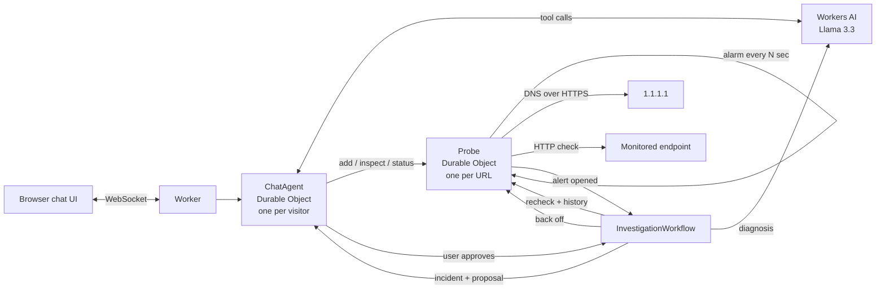

# cf_ai_oncall

An AI on-call engineer for your web services, built entirely on Cloudflare.

It watches your endpoints from Cloudflare's edge, learns what "normal" looks like for each one, and when something breaks it investigates on its own, writes a diagnosis with Llama 3.3, and posts it in your chat. If it wants to change something, it asks first and waits for your answer.

**Live demo:** https://cf-ai-oncall.sharvary-salgaonkar27.workers.dev

<!-- Add a screenshot or GIF here: docs/demo.gif -->

## Try it

## Testing the live demo

Open https://cf-ai-oncall.sharvary-salgaonkar27.workers.dev (each browser gets its own private session). About 10 minutes end to end:

1. **Deep check:** click `Inspect https://api.github.com/users/octocat`. The reply covers DNS (via 1.1.1.1), status, and GitHub's real rate-limit headers (limit, remaining, reset).
2. **Start monitoring:** click `Monitor https://example.com every 60 seconds`. The first check runs immediately; after that a Durable Object alarm checks it every minute on its own.
3. **Add a failing endpoint:** type `Monitor https://httpbin.org/status/503 every 60 seconds`.
4. **Wait about 3 minutes without typing.** After 2 failed checks a `down` alert opens and a Workflow investigates: it waits 30s, rechecks, compares with history, and Llama 3.3 writes a diagnosis. The incident appears in chat on its own, with a **suggested action**.
5. **Approve it:** type `approve`. The paused Workflow resumes, slows the checks to every 5 minutes, and confirms in chat.
6. **Ask about it:** click `Is anything wrong?` for open alerts, or `Write a postmortem for the latest incident` for a postmortem built from the recorded timeline.
7. **Clean up:** `Stop monitoring httpbin`.

Other things to try: `Inspect https://www.linkedin.com/in/anyone` (detected as bot blocking, not "down"), `Inspect https://this-domain-does-not-exist-12345.com` (NXDOMAIN).

## How it maps to the assignment

| Requirement | Implementation |
|---|---|
| **LLM** | Llama 3.3 70B (`@cf/meta/llama-3.3-70b-instruct-fp8-fast`) on Workers AI: chat with tool calling, plus incident diagnosis |
| **Workflow / coordination** | Durable Object alarms schedule the checks; a **Cloudflare Workflow** runs each investigation as durable, retried steps and **pauses for human approval** (`waitForEvent`) |
| **User input** | Chat UI over WebSockets (Agents SDK, `AIChatAgent`), served by the same Worker |
| **Memory / state** | Durable Object SQLite: chat history, endpoints, every check result, alert events and incidents |

## Architecture



**The flow:** a Probe checks its URL on a timer and runs anomaly detection after every check. When an alert opens, it starts an investigation Workflow: wait 30s to rule out a blip, recheck, gather history, ask Llama 3.3 for a diagnosis, post the incident to the chat, then **pause** until the user approves or dismisses the suggested action (30 minute timeout). On approval the Probe slows its checks; when the alert resolves it restores the normal interval and announces the recovery.

## What it detects

Each endpoint builds a baseline (median and p90 latency, error rate) from its own history.

| Alert | Rule | Severity |
|---|---|---|
| `down` | 2 failed checks in a row | critical |
| `error_burst` | 3+ failures in the last 6 checks | warning |
| `latency_spike` | 2 checks in a row above max(3× median, median + 300ms) | warning |
| `dns_failure` | NXDOMAIN or SERVFAIL from 1.1.1.1 | critical |
| `rate_limited` | HTTP 429 or zero quota left | warning |
| `quota_low` | 10% or less of the rate-limit quota left (warns *before* the 429) | warning |
| `blocked` | bot blocking (LinkedIn's 999, Cloudflare challenge, redirect to a login wall) | warning |

Requiring two consecutive bad checks avoids paging on one-off blips. Blocking and rate limiting are reported separately, so a site that blocks bots isn't reported as "down". Alerts open once and resolve once, so one incident produces one alert, not one per check.

Rate-limit parsing handles `X-RateLimit-*`, `RateLimit-*`, the combined `RateLimit` header (both IETF draft formats), `Retry-After` as seconds or an HTTP date, and reset values sent as unix timestamps (GitHub style).

## Design decisions

- **Deterministic data path, LLM control path.** Checks, detection, baselines and postmortem numbers are plain TypeScript. The LLM explains, diagnoses and drives tools; it never decides whether something is down or computes a duration. This keeps the facts reproducible and testable, and the model can't invent numbers.
- **One Durable Object per endpoint.** Each Probe has its own SQLite history and its own alarm, so endpoints are isolated and checks keep running when nobody is connected.
- **Workflows for investigations.** Each step's result is persisted, so a failure retries that step instead of the whole investigation, and `waitForEvent` lets it wait 30 minutes for a human at no cost.
- **Ask before acting.** The only action the agent can take (backing off checks) requires explicit approval and undoes itself on recovery.
- **Public demo safety.** Per-visitor sessions (a random agent name stored in localStorage) and a cap of 5 endpoints per session.

## Debugging notes

Things that broke along the way, and how they were fixed:

1. **Every streamed word arrived twice** with Llama 3.3 (`workers-ai-provider` 3.3.1). Logging text deltas on the server showed the duplication happened before the UI. Fixed with a small AI SDK middleware (`wrapLanguageModel`) that drops the second copy of each duplicated delta, while keeping real repeats like "ha ha".
2. **Tool calls failed with an opaque "An error occurred."** The debugger showed the tool arguments were doubled too: `{"url": "{"url": "httpshttps://://...`. The middleware now also dedupes tool-input deltas and, if the final JSON is still invalid, rebuilds it by un-doubling the string (a small backtracking search that keeps the first result that parses).
3. **The model called the same tool in a loop.** Fixed with `prepareStep`: once a step has run tools, the next step gets no tools, so the model must answer with the results.
4. **No incident appeared** after adding the Workflow. The `down` alert had been open since before the Workflow existed, and investigations only start when an alert *opens*. Found by checking each link of the chain from chat, then adding stage-by-stage logs.
5. **Postmortems blamed the wrong session.** Stopping monitoring cleared alerts silently, so a postmortem walked back into an earlier session. Now `stop()` records a "monitoring stopped" resolution, and the impact search stops at the previous alert's end.

## Project structure

```
src/
  server.ts        Worker entry + ChatAgent (chat, tools, incidents)
  probe.ts         Probe Durable Object (scheduled checks, detection, back-off)
  checks.ts        One full network check (DNS, redirects, headers, block hints)
  detect.ts        Baselines, anomaly rules, open/resolve lifecycle
  investigate.ts   InvestigationWorkflow (recheck, diagnose, approval)
  incident.ts      Evidence, proposals, chat message formatting
  postmortem.ts    Incident timeline and impact numbers
  app.tsx          React chat UI
test/              Vitest unit tests for all the pure logic (67 tests)
```

## Run it locally

Requirements: Node 18+, a Cloudflare account (the free plan works).

```bash
git clone https://github.com/sharvary27/AI-OnCall-Agent.git
cd AI-OnCall-Agent
npm install
npx wrangler login
npm run dev
```

Workers AI has no local simulator, so `npm run dev` runs inference on Cloudflare. Your account needs a `workers.dev` subdomain (Workers & Pages in the dashboard).

```bash
npm test          # unit tests
npm run deploy    # deploy to your workers.dev subdomain
```

## Limitations

- **No TLS certificate details.** Workers' `fetch` doesn't expose the certificate, so expiry can't be checked; an invalid certificate shows up as a failed request.
- **Checks run from one location per Probe,** not from multiple regions, so a regional outage elsewhere won't be seen.
- **Latency is time to response headers** measured inside a Worker, not full page load.
- **The only automated action is backing off checks.** Real remediation (restarts, rollbacks) is out of scope on purpose.
- **Llama 3.3 on Workers AI streams duplicated deltas** with the current provider version; the middleware works around it and can be removed once that's fixed upstream.

## AI-assisted development

Built with AI assistance (Claude). The full prompt history is in [PROMPTS.md](./PROMPTS.md).